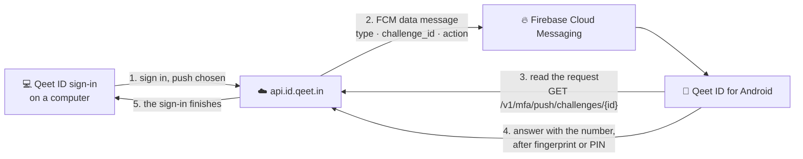

<div align="center">

# 🔑 Qeet ID for Android

**The Qeet ID authenticator, native on Android: sign-in codes that work offline, and a quick, safe way to approve
Qeet ID sign-ins from your phone.**

[-3DDC84?logo=android&logoColor=white)](#-building)
[](#-stack)
[](#-stack)
[](https://github.com/qeetgroup/qeetrix-android)
[](docs/firebase.md)

[🧭 Architecture](docs/llm/architecture-map.md) · [🔒 Security](SECURITY.md) · [🔥 Firebase](docs/firebase.md) · [📝 Changelog](CHANGELOG.md) · [🤖 Agents](AGENTS.md)

</div>

## 📱 What it does

| | |
|:--|:--|
| 🔢 **Sign-in codes** | Time-based one-time codes (RFC 6238) for Qeet ID and any site with 2-step verification. Scan the setup QR code or type the key. Computed on the phone, so they work offline |
| ✅ **Approve sign-ins** | Link the phone once with a pairing code from Qeet ID. Each sign-in then arrives as a request: check where it comes from, type the 2-digit number from the sign-in screen, and confirm with your fingerprint, face or PIN |
| 🔒 **App lock** | Fingerprint, face or screen lock to open the app, asked again after 30 seconds away |
| 🙈 **Kept on this phone** | Secrets are sealed by the Android Keystore, never backed up, never sent to Qeet ID, and hidden from screenshots and the recent-apps preview |
| 🌗 **Light and dark** | Follows the phone. Built entirely from [Qeetrix for Android](https://github.com/qeetgroup/qeetrix-android) components and tokens |

## 🔗 How it fits



The phone holds no signed-in session. A **one-time pairing code** links it; after that a **device credential**, sealed
in the Keystore, answers for it. When a push message is lost, the app asks the server for waiting requests each time it
comes to the foreground.

## 🧩 Screens

| Area | Screens |
|:--|:--|
| 👋 Getting started | Welcome · Lock Qeet ID · Get sign-in requests (notification primer) |
| 🔢 Sign-in codes | Accounts (search, approvals row, problem alerts, Copied) · No accounts yet · Scan a QR code · Camera not allowed · Type the setup key · Account actions · Delete · Rename |
| ✅ Sign-in approvals | Link this phone · Scan the pairing code · Name this phone · Phone linked · Sign-in request (number + biometric prompt) · Approved · Blocked · Ended |
| ⚙️ Lock and settings | Locked · Settings (linked account, app lock, hide codes until tapped, help) · Unlink this phone |

## 🛠️ Stack

| | |
|:--|:--|
| 🤖 Platform | Android 10 (API 29) and later; compile and target SDK 37 |
| 🎨 UI | Jetpack Compose and [Qeetrix for Android](https://github.com/qeetgroup/qeetrix-android) 0.1.0, from source |
| 🧭 Navigation | Navigation Compose with type-safe routes; ViewModel + StateFlow; manual dependency injection |
| 🔐 Secrets | Android Keystore AES-256-GCM, one sealed file per account secret, in the no-backup directory |
| 👆 Verification | AndroidX Biometric (`BiometricPrompt`: strong biometric or the screen lock) |
| 📷 Scanning | CameraX and ZXing, on the phone |
| 🌐 Network | OkHttp and kotlinx.serialization; HTTPS only |
| 🔔 Push | Firebase Cloud Messaging (optional at build time) |

## 🔨 Building

You need JDK 17 or later (21 recommended) and the Android SDK with platform 37 and build tools 36.

```sh
echo "sdk.dir=$HOME/Library/Android/sdk" > local.properties   # or set ANDROID_HOME
scripts/fetch-qeetrix.sh                                       # Qeetrix for Android at the pinned release
./gradlew build                                                # assemble, unit and UI tests, lint, ktlint
./gradlew :app:installDebug                                    # on a phone or an emulator
```

Qeetrix for Android is built from source in the same Gradle run (a composite build of
[`qeetrix-android`](https://github.com/qeetgroup/qeetrix-android) pinned to `v0.1.0` and its commit, in
`gradle.properties`), so no GitHub Packages token is needed. To work on the library beside the app, set
`qeetrix.dir=../../qeetrix/qeetrix-android` in `local.properties`.

### 🧪 Against a development server

A release build always talks to `https://api.id.qeet.in`. A debug build can be pointed at a server on your machine or
LAN, over plain HTTP:

```properties
# local.properties
qeetid.apiUrl=http://10.0.2.2:4001   # the emulator's address for your computer
```

Without Firebase, a debug build links with a stand-in push token, and requests reach it when the app comes to the
foreground, or through the debug entry point:

```sh
adb shell am broadcast -n com.qeetgroup.qeetid/.debug.DebugPushReceiver \
    --es type sign_in_request --es challenge_id 7f9c2a40-1b8e-4d2c-9a51-3e6f0b2d8c11 --es action sign_in
```

### 🚀 Release builds

```sh
./gradlew :app:assembleRelease    # R8 and resource shrinking; signed when keystore.properties exists
```

Signing reads `keystore.properties` at the repository root (never committed):

```properties
storeFile=release.jks
storePassword=…
keyAlias=qeet-id
keyPassword=…
```

Push needs the Firebase app config, `app/google-services.json` (never committed): see [docs/firebase.md](docs/firebase.md).

## 🌐 The routes the app calls

| Purpose | Route | Credential |
|:--|:--|:--|
| Link the phone | `POST /v1/mfa/push/pairing/claim` | The one-time pairing code |
| Read a sign-in request | `GET /v1/mfa/push/challenges/{id}` | None (the id) |
| Approve or deny it | `POST /v1/mfa/push/challenges/{id}/respond` | Device credential, and the number to approve |
| Requests waiting for the phone | `POST /v1/mfa/push/devices/{id}/pending` | Device credential |
| A new push token | `POST /v1/mfa/push/devices/{id}/push-token` | Device credential |
| Unlink the phone | `POST /v1/mfa/push/devices/{id}/unlink` | Device credential |

The device credential is `user_id` and `device_token` in the JSON body. No route takes a bearer token or a cookie.

## 📚 Learn more

| | |
|:--|:--|
| 🤖 [AGENTS.md](AGENTS.md) | Rules and commands for anyone changing the code |
| 🗺️ [Architecture map](docs/llm/architecture-map.md) | Where everything is |
| 📖 [Context](docs/llm/context.md) | How the app works, and its known gaps |
| 🔥 [Firebase](docs/firebase.md) | Push setup, and testing without it |
| 🔒 [Security](SECURITY.md) | What the app protects, and how to report a vulnerability |

---

<div align="center">

Made with 🧡 by Qeet Group · [⬆️ Back to top](#-qeet-id-for-android)

</div>
